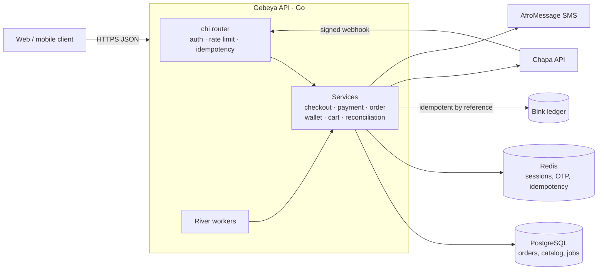
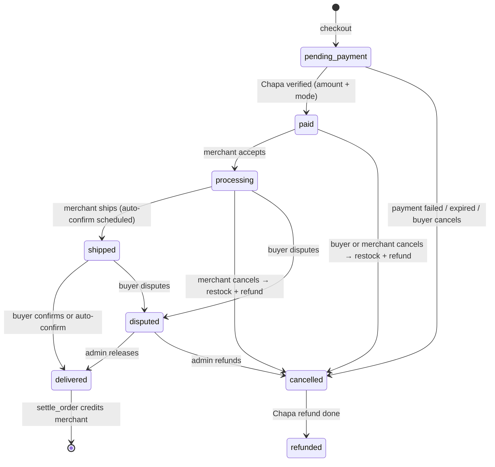
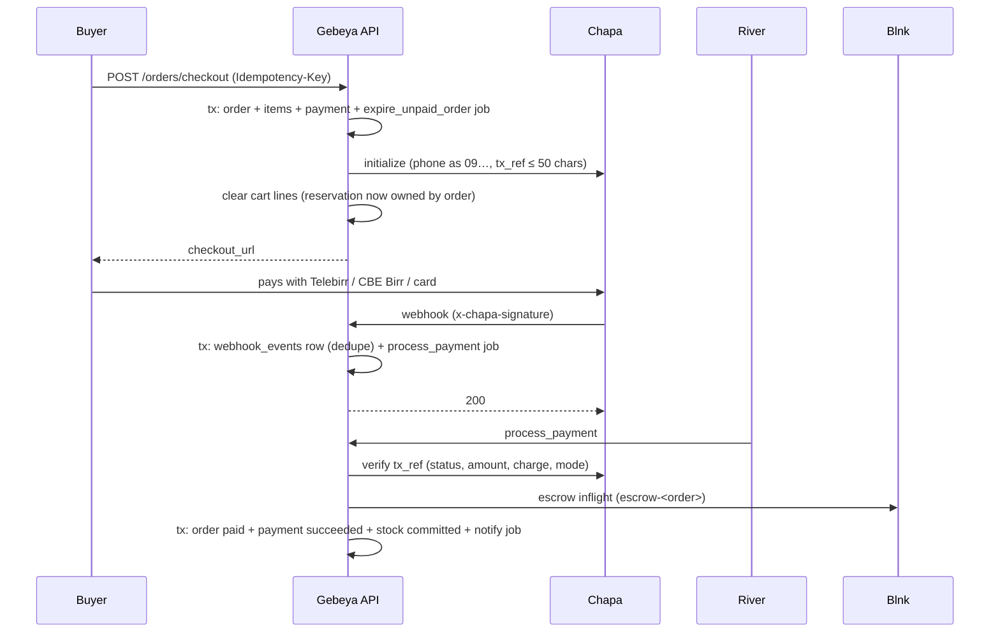

# Architecture

Gebeya is a single Go service in front of three stateful systems: PostgreSQL (business data and the River job queue), Redis (sessions, refresh tokens, rate limits, idempotency keys and SMS codes), and Blnk, a self-hosted double-entry ledger that is the source of truth for money. Chapa, Ethiopia's licensed payment gateway, moves real money in and out. AfroMessage delivers SMS.

## Layers

| Layer | Package | Responsibility |
|---|---|---|
| HTTP | `internal/http`, `internal/http/handler`, `internal/http/middleware` | Parse, validate, authorize, call one service method, write JSON. No business rules. |
| Services | `internal/service` | All business rules and orchestration. Each method that changes state does it in one DB transaction and enqueues follow-up jobs inside that same transaction. |
| Jobs | `internal/jobs` | River job types and thin workers. Workers call services through small interfaces (`PaymentProcessor`, `OrderSettler`, …) to avoid an import cycle. |
| Data | `internal/repository`, `internal/db` | sqlc-generated queries (`sqlc/queries/*.sql`) wrapped in repositories that map rows to domain types and errors to `internal/errors`. |
| Integrations | `internal/blnk`, `internal/chapa`, `pkg/sms` | Clients for the ledger, payments and SMS, plus an in-memory Chapa fake for development. |
| Shared | `pkg/phone`, `pkg/jwt`, `pkg/password`, `pkg/validation`, `pkg/logger`, `pkg/response` | Reusable building blocks. |

Wiring happens in one place, `cmd/api/main.go`. The router receives every dependency through `apphttp.Deps`.

## Ledger model (Blnk)

All amounts are integer santim (1 ETB = 100), sent to Blnk as `precise_amount` with precision 100.

| Balance | Purpose |
|---|---|
| `@World` | Blnk's external-world account: money entering from Chapa or leaving through transfers |
| Escrow | Buyer payments held until delivery |
| Revenue | Platform fees |
| Processing fees | Chapa's charges, which the platform absorbs |
| One per merchant | The merchant's wallet |

Every transaction has a deterministic reference, so a retried job finds the existing transaction (`TXN_DUPLICATE_REFERENCE` → `GetByReference`) instead of moving money twice:

| Event | Reference | Movement |
|---|---|---|
| Payment verified | `escrow-<order>` | @World → Escrow, **inflight** (total incl. delivery) |
| Settlement | (commit of the escrow inflight) | inflight → applied |
| Settlement | `sale-credit-<order>` | Escrow → Merchant: subtotal − fee + delivery |
| Settlement | `platform-fee-<order>` | Escrow → Revenue: fee on goods subtotal |
| Settlement / refund / reversal | `chapa-fee-<order>` | Revenue → Processing fees: Chapa's charge (overdraft allowed) |
| Payout requested | `payout-<payout>` | Merchant → @World, **inflight** (hold) |
| Payout completed | (commit of the hold) | hold → applied |
| Reversal after settlement | `reversal-<order>` | Merchant → @World (overdraft allowed) |

Inflight commits and voids are sent with `skip_queue: true`. Otherwise Blnk 0.15 queues them, and the merchant credit could run before the escrow commit has landed.

## Order lifecycle

Status changes go through `orderRepository.Transition(id, to, from...)`, a compare-and-set `UPDATE … WHERE status = ANY(from)`, so concurrent workers cannot apply conflicting transitions.

## Payment confirmation

The same `PaymentService.ProcessPayment` is reached from four paths: the webhook, Chapa's GET callback, the buyer's "refresh payment" button, and the expiry job, which checks Chapa one last time before cancelling. Webhook bodies are never trusted for money movement.

## Background jobs (River)

| Job | Enqueued by | Does |
|---|---|---|
| `process_payment_webhook` | webhook, callback | Verify with Chapa → paid / cancelled |
| `expire_unpaid_order` | checkout (+`ORDER_PAYMENT_TIMEOUT`) | Last Chapa check, then cancel and release stock |
| `settle_order` | delivery confirmation, dispute release | Commit escrow, credit merchant, book fees |
| `auto_confirm_delivery` | shipping (+`AUTO_CONFIRM_DELIVERY_DAYS`) | Confirm if still shipped (not disputed) |
| `refund_order` | cancellation after payment, dispute refund | Void escrow, Chapa refund, book the fee |
| `process_payment_reversal` | webhook (`charge.reversed`, payload-signed) | Cancel or claw back from the merchant |
| `process_payout` | admin approval | Chapa transfer → verify → commit/void hold |
| `mark_cart_expired` | cart creation | Release reservations, abandon or delete cart |
| `send_order_notification` | state changes | Amharic + English SMS |
| `reconcile_ledger` | periodic, 03:00 Africa/Addis_Ababa | Compare Blnk with Postgres |

Jobs are inserted with `jobs.Enqueuer.EnqueueTx` inside the business transaction, so a job exists if and only if its state change committed. Services return `jobs.ErrNotReady` when an external system is still pending, and the worker snoozes the job instead of failing it.

## Stock

`inventory.quantity` is on hand and `reserved` is held. A cart line reserves stock; checkout transfers the cart's reservation to the order instead of reserving again; payment commits it (quantity and reserved both decrease); an unpaid cancellation releases it; a paid cancellation restocks. Every stock update is a conditional `UPDATE … RETURNING rows` that reports when there wasn't enough.

## Security notes

- **Auth:** RS256 JWT access tokens (15 min) and rotating refresh tokens stored in Redis. Deactivated users cannot log in or refresh.
- **Phones:** every Ethiopian number format is normalized to `+2519…`/`+2517…` (`pkg/phone`). Phones are verified by SMS code, which is HMAC-hashed, expires after 5 minutes, allows 5 attempts, and has a 60-second resend cooldown.
- **Idempotency keys:** scoped per user, with a Redis lock against concurrent duplicates. A replay returns the original status.
- **Webhooks:** signatures are checked against the webhook secret. Reversals additionally require the payload HMAC.
- **Rate limits:** a global limit plus a stricter one on auth and SMS endpoints. Limiters fail open if Redis is down. Client IPs come from the socket unless `TRUSTED_PROXY_COUNT` is set.
- **Blnk:** runs with `BLNK_SERVER_SECURE=true`, so every ledger call needs the API key.

## Testing

- **Unit tests:** run with `go test -short ./...`.
- **Integration tests:** use one Postgres and one Redis container per package (testcontainers). Each test clones a fresh database from a migrated template, so the suite runs in about 15 seconds.
- **Service flows:** the harness in `internal/service/harness_test.go` runs real Postgres and mocks Blnk and Chapa (`internal/mocks`).
- **End to end:** `scripts/e2e-money-flow.sh` drives the whole money flow through HTTP against real Blnk and checks ledger balances.
